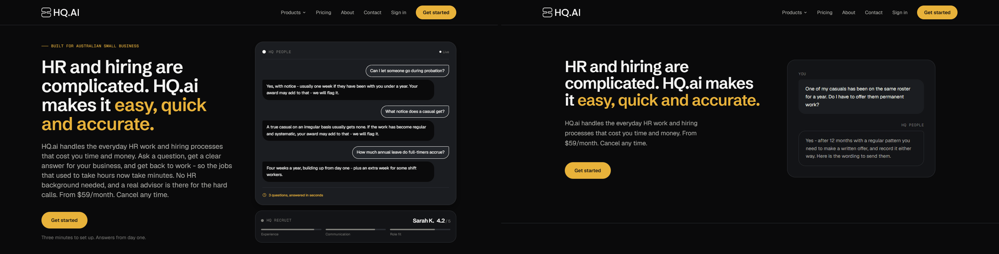

# Design pilot: the homepage under the `image-to-code` skill

A side-by-side candidate for `/`, built so the real home page stays untouched.

- **Route:** `/_design/image-to-code`
- **Source:** `app/%5Fdesign/image-to-code/` (`page.tsx` + `ToolPanels.tsx`)
- **Added:** November 2026, on branch `skill/image-to-code`
- **Status:** a design exercise for comparison. Not wired to any navigation,
  `noindex`, and nothing depends on it. Delete the folder and nothing breaks.

## The images

The opening screen on each, live left, pilot right:

- `home-hero-live-vs-pilot.png` - the opening screen on each
- `home-full-live-vs-pilot.png` - both pages end to end

Both captured in headless Chrome at 1440 wide, in one session, with the hero
entrance and the `data-app` flip allowed to settle first. Recaptured after the
branch was rebased onto `main` at `f139192`, so the live side shows the current
hero (full chat transcript, fourth exchange cut) rather than the older one.

## Why this exists

The `image-to-code` skill (Leonxlnx/imagegen-skills) is image-first: generate
design references, analyse them, then write code to match. It treats the
generated image as "the primary visual source of truth" and the code as "the
translation layer", and it tells you to preserve the palette you extract from
the render.

That premise collides with this codebase. Our source of truth is the token
system in `tailwind.config.ts` and `app/globals.css`, and CLAUDE.md forbids
hardcoding a colour anywhere. Both cannot be the source of truth.

So the skill was applied in halves:

- **Not used - the brand-invention half.** Its "pick a theme paradigm /
  background character / typography character" engine, and its rule to sample
  the palette out of the render. Those decisions were already made
  deliberately, and `globals.css` documents AA contrast work that sampling an
  image would quietly break.
- **Used - the composition half.** Hero minimalism, the small-laptop first
  view, anti-nested-box, micro-UI clutter, section rhythm, density. All of it
  brand-agnostic, and all of it pointing at real faults on the live page.

Four references were generated (hero, contrast, product showcase, closing CTA),
each prompted hard against the existing dark marketing brand so generation could
not invent a palette. They agreed on: at most one framing container per section,
hairlines instead of bordered-and-filled cards, no icons, gold once per section,
eyebrows occasional, and 20-30 per cent of every frame left empty.

**No copy came from the renders.** They invented claims - payroll,
superannuation, Fair Work rule tracking, "Book a demo" - that HQ.ai does not
make. Every string in the pilot is carried from the live landing components or
from `lib/pricing-config.ts`.

## What changed

Measured in the browser at 1440, both pages, same header and same tokens, in the
same run. An element counts as a text block or a micro-label on its own direct
text nodes, not on being a childless leaf: every live eyebrow wraps a ``
dash rule, so a leaf-only test silently scores all of them as zero.

| | live `/` | pilot |
|---|---:|---:|
| hero height | 809px | 573px |
| hero headline lines | 4 | 3 |
| **words in the hero** | **238** | **86** |
| discrete text blocks in the hero | 27 | 7 |
| rounded containers in the hero | 15 | 3 |
| CTAs in the hero | 1 | 1 |
| **SVG icons on the whole page** | **50** | **0** |
| mono uppercase micro-labels | 23 | 15 |
| sections carrying a gold eyebrow | 9 of 10 | 5 of 10 |
| those eyebrows with a leading gold dash rule | 9 | 0 |
| sections | 10 | 10 |
| full page height | 8870px | 8822px |

Section by section:

- **Hero.** The live hero puts eight blocks above the fold: eyebrow, headline,
  a five-sentence subhead, CTA, caption, the chat card, a second HQ Recruit
  scorecard tile, and a 3-up feature strip. The pilot keeps four: headline, two
  lines of support, one CTA, one card.
- **Problem.** Three bordered, filled, shadowed cards - each with an inner
  header row and two circular icon badges - become three hairline columns.
- **Industries.** Fifteen bordered cards with fifteen bespoke SVG icons behind a
  carousel become the same fifteen as plain hairline text entries, all visible
  at once.
- **Customer story.** Loses its card and its decorative quote-mark glyph; the
  type carries it instead.
- **Pricing.** Three separate cards become one container with hairline columns.
- **Eyebrows.** Drop from 9 of 10 sections to 5, and lose the leading gold dash
  rule entirely.

The total height barely moves (8870px against 8822px) on the same ten sections
with the same copy. The content did not shrink. The chrome did.

The micro-label count is the weakest of these numbers: 23 against 15 is a real
reduction but not the step change the others are, because the pilot still leans
on mono eyebrows to label its hairline columns where the live page uses a card
header instead.

## What this is not

A verdict. The pilot drops things the live page may well want on purpose: the
hero feature strip and the caption are conversion furniture, and the carousel is
what keeps the industries section short rather than a wall of fifteen entries.
The defensible read is that the live page is denser than it needs to be in the
hero and over-boxed throughout - not that this should replace it wholesale.

Two known rough edges in the pilot, both left deliberately:

- The headline still runs to four lines at 390px. Getting it to three would mean
  shrinking it below hero scale, and rewriting the copy was out of scope.
- `MarketingHeader` sets `data-app` in an effect, so marketing pages paint in the
  light `:root` palette for one frame before flipping to the dark marketing ramp.
  That is pre-existing and affects the live page identically.

## Reproducing the captures

With the dev server running (`npx next dev -p 3403`), drive the installed Chrome
through the `puppeteer-core` already in the dependency tree: load each of `/` and
`/_design/image-to-code` at a 1440 viewport, wait for
`document.documentElement.dataset.app === 'marketing'`, scroll to the bottom and
back to force the lazy sections to render, then take a `fullPage` screenshot.
Stitch the pair side by side and quantise to a 256-colour palette - lossless to
the eye on a flat dark UI, and it keeps the full-page pair under 500KB.

Note that `/` and every other page send `X-Frame-Options: DENY` from
`next.config.js`, so a live side-by-side in two iframes will not work, even
same-origin. Capture to images instead rather than weakening that header.

## Two traps if you build another pilot route

1. **`app/_design/...` does not route.** An underscore-prefixed folder is a
   *private folder* in the App Router and is excluded from routing, so it 404s.
   Next's documented escape is to name the folder `%5Fdesign`, which serves at
   `/_design`. That is why the folder on disk looks the way it does.
2. **Turbopack will not start in a worktree whose `node_modules` is a junction.**
   It rejects the link with "points out of the filesystem root". `--webpack` gets
   further and then dies on `tailwind.config.ts`. The fix that leaves the repo
   alone: remove the junction with `cmd /c rmdir node_modules` - which removes
   the link only, not the target, so do not let npm delete it and do not
   `rm -rf` it - then run `npm ci`.

## Keeping it current

The pilot reads the same tokens as the live page, so a token change on `main`
lands here too. The rebase onto `f139192` picked up PR #4, which split
`ink-on-clay` out of `ink-on-accent`; the pilot's five gold fills were relabelled
`text-ink-on-clay` to match. Verified in the browser: every gold control on both
pages resolves to `rgb(17, 17, 17)` on `rgb(232, 178, 58)`, 9.8:1.
